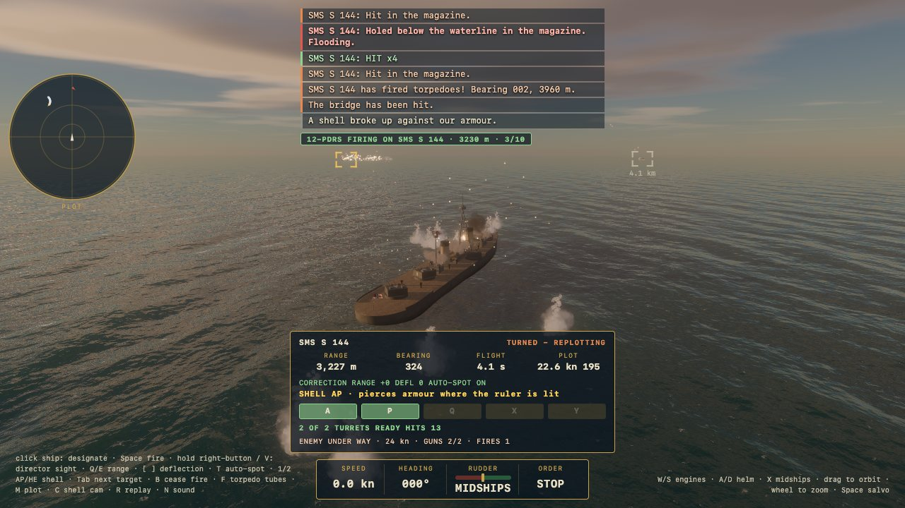
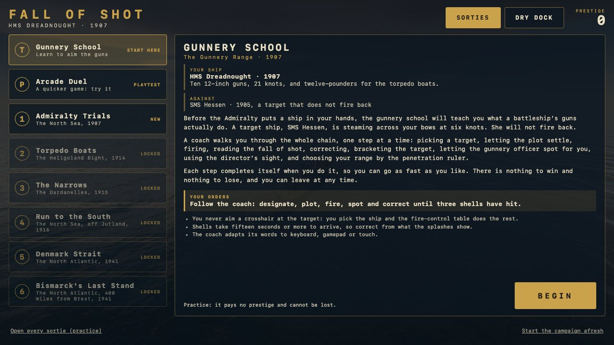
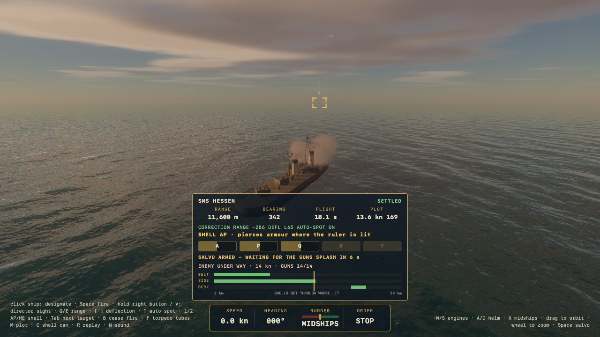
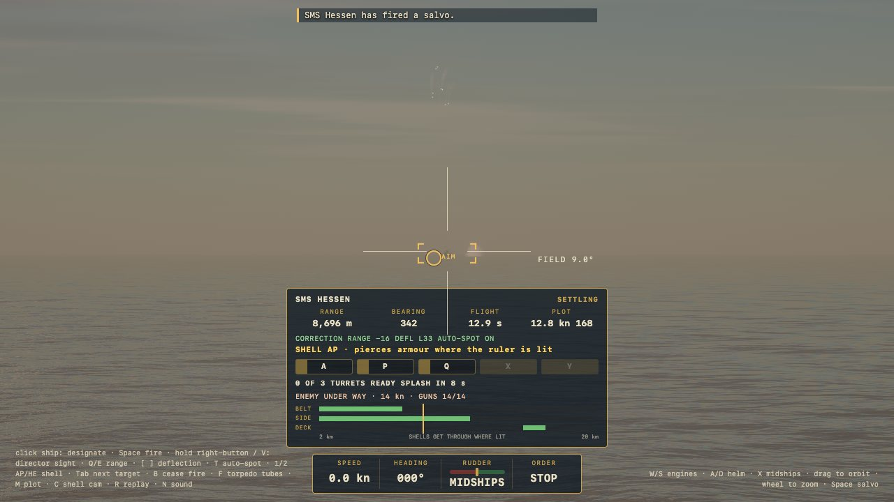
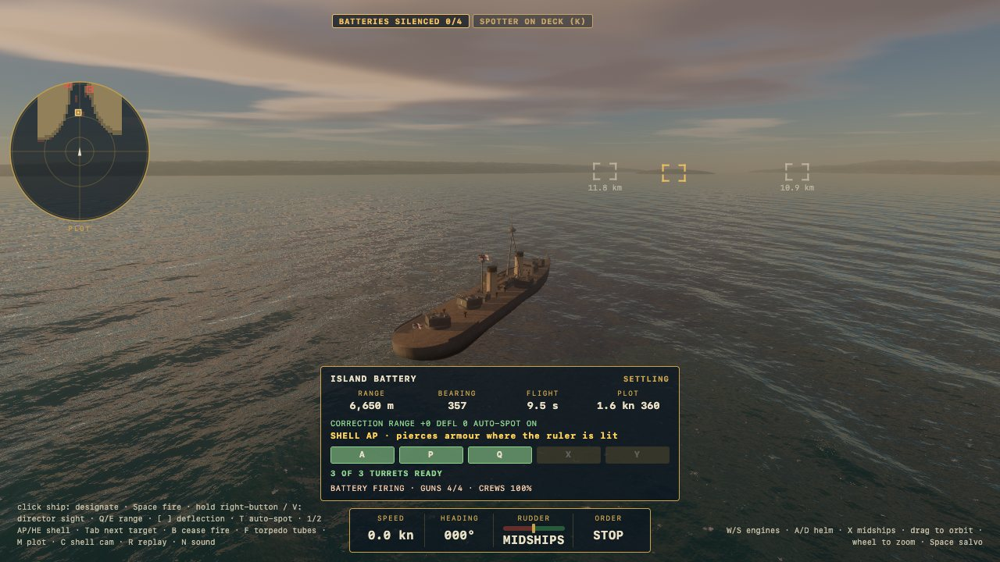
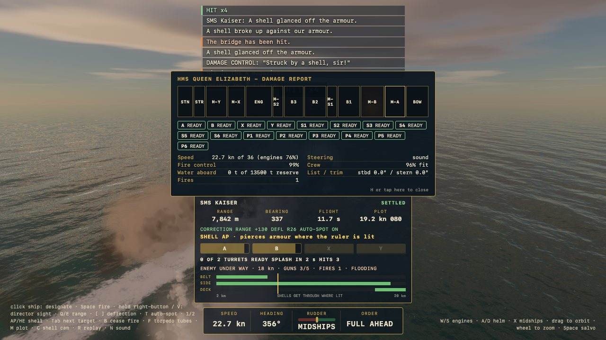
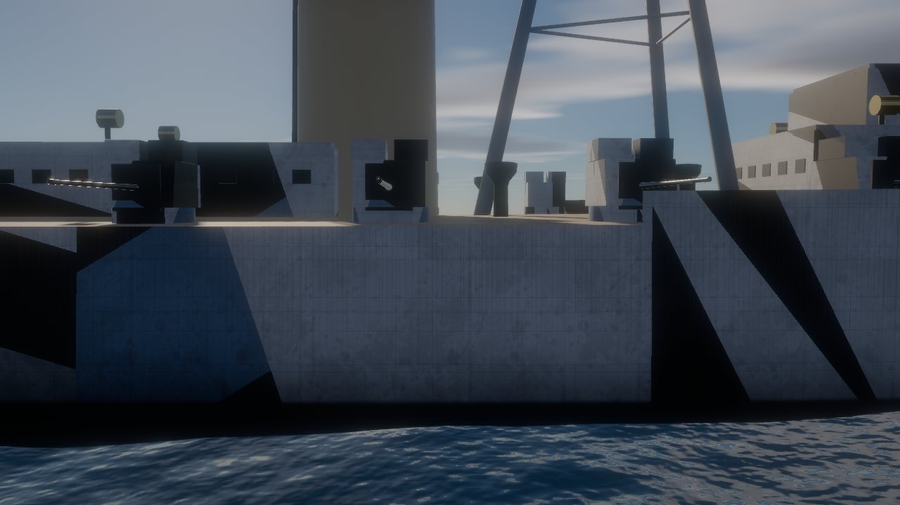
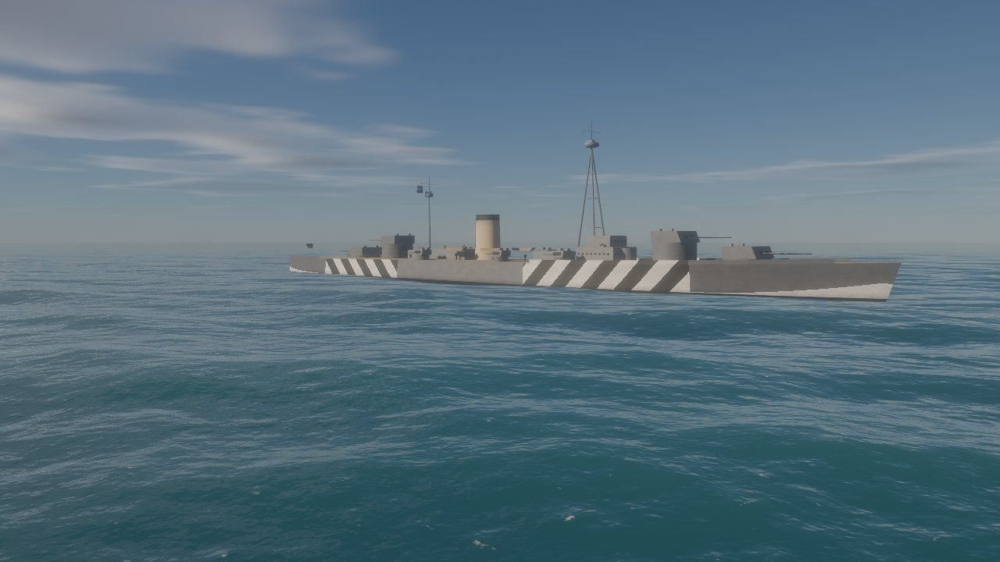
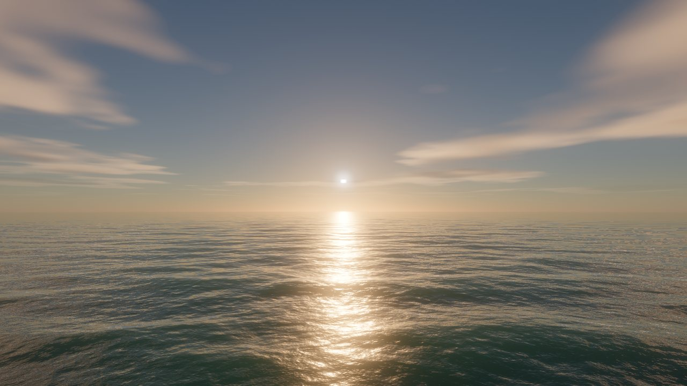

# Fall of Shot

A dreadnought gunnery game drawn with raw WebGPU. You command a British battleship between 1906 and 1941, from HMS Dreadnought to King George V, against enemy ships and shore batteries, on an FFT ocean under a physically based sky, with the fire control, armour and damage of the real ships behind the picture.

**Play it:** <https://fall-of-shot.pages.dev/> (Chrome or Edge, or Safari 26 on a Mac or iPad; on the iPad, add it to the home screen for the full-screen app). Keyboard and mouse, a gamepad, or touch.



## What you do

A battleship does not aim a gun. You pick a target, the rangefinder reads her, the plot works out her course and speed, and the guns are laid where she will be when the shells arrive fifteen to forty seconds later. Then you read the fall of shot, correct, bracket her, and choose your range from the penetration ruler: close in, shells punch through the side; far out, they drop on the deck. The enemy does the same to you. Ships flood, list, burn, lose turrets, blow up, or strike their colours; you may cease fire and take the prize, and firing on a ship that has struck costs you.

| | |
|---|---|
|  |  |
| The campaign's front door: six sorties, a gunnery school and a dockyard | A duel at 11,600 m: the plot settled, the salvo armed, the ruler lit where shells get through |
|  |  |
| The director's sight from the foretop | The Narrows: forts in the hills, mines, shoals and a spotter aircraft |
|  |  |
| The damage report: compartments, turrets, water aboard, fires | Dazzle paint, weathering and plating on a Queen Elizabeth |
|  |  |
| Bismarck in her Baltic scheme of May 1941, as she comes into the Denmark Strait | The sea at golden hour |


## What is in it

- **Sea and sky.** A JONSWAP spectrum drives three FFT cascades in compute shaders, with foam, glitter and wakes that persist and advect; a Hillaire atmosphere with clouds; a real horizon with the earth's curvature, so distant ships appear mast-first. The sea's grid is drawn only in the arc the camera can see.
- **Ships from a Forge.** Every hull is lofted from one declarative spec that also gives the armour, the compartments and the hit volumes, so what you see is what you can hit. Hull numbers, turret letters, ensigns, weathering and dazzle paint are drawn from the same data: the Admiralty's angular patches for a British ship that has had the refit, and Bismarck's Baltic chevrons and false bow waves of 1941.
- **Honest fire control.** Rangefinder error that grows with the square of the range and keeps a bias no averaging removes; a plot that settles and decays when the target turns; dispersion per shell and per salvo; wind and Coriolis; an auto-spotter that applies the fall of shot; armour-piercing and high-explosive rounds.
- **Damage that disables.** De Marre penetration against belt, side, deck, barbettes and turrets; compartments that flood and burn; list, trim and sinking; magazine flash; steering and fire-control casualties; crews that strike. Hits leave scorches and holes on the hull; a magazine going up breaks her in two.
- **Torpedoes, destroyers and smoke.** Fast and slow settings, defects, arming runs, wakes the lookouts call by bearing, smoke screens that shut the rangefinder.
- **Islands and forts.** Defilade behind hills, forts that give themselves away by their flash, hidden howitzers found by the spotter aircraft, shoals that ground you and minefields the aircraft marks.
- **Eight ships.** HMS Dreadnought, Queen Elizabeth, Rodney and King George V to command; SMS Hessen, Kaiser, Bismarck (sound and wounded) and destroyers against you, each with her own handling, guns, armour and captain.
- **Shell camera and replay.** Ride a salvo to its splash in slow motion; review the last half minute of the fight from any camera.
- **Sound.** Every spectacle is heard where it happened, late by the speed of sound; the crew call hits, wakes and casualties.
- **Three ways to play it.** Keyboard and mouse, gamepad, and an iPad touch HUD with a ship's wheel and an engine-order telegraph, all feeding one intent stream. A realistic pace and a quicker arcade pace.
- **The same fight every time.** The simulation runs in fixed steps and reads nothing from the frame, so a seed gives the same fight at any frame rate, in the browser or in the headless test harnesses.

## Controls

| | Keyboard and mouse | Gamepad | Touch |
|---|---|---|---|
| Engines | W / S | left stick up / down | telegraph lever |
| Helm | A / D, X midships | left stick | ship's wheel |
| Pick a target | click her, Tab cycles | RB / LB | tap her |
| Fire | Space (hold for continuous) | RT | FIRE |
| Director's sight | hold right button or V, wheel zooms | hold LT, R3 / L3 zoom | SIGHT, pinch to zoom |
| Corrections | Q / E range, [ / ] deflection | D-pad | RANGE and DEFL steppers |
| Auto-spot | T | A | AUTO SPOT |
| Shell | 1 AP, 2 HE | LT + A | SHELL |
| Cease fire | B | B | CEASE |
| Torpedo tubes | F | X | TORPEDO |
| Chart | M | Select | PLOT |
| Spotter aircraft | K | L3 | SPOTTER |
| Damage report | H | Y | DAMAGE |
| Shell camera / replay | C / R | R3 / LT + Y | SHELL CAM / REPLAY |
| Camera | drag to orbit, wheel to zoom | right stick | drag, pinch |
| Sound | N | | SOUND |
| Pause | P or Esc | Start | |

## The campaign

Gunnery School (a coached course against a target that does not fire back), then six sorties, each unlocked by winning the one before: Admiralty Trials (1907, Dreadnought against a pre-dreadnought), Torpedo Boats (the Heligoland Bight), The Narrows (the Dardanelles, 1915, in a Queen Elizabeth), Run to the South (Jutland, 1916), Denmark Strait (1941, King George V against Bismarck) and Bismarck's Last Stand (Rodney against a crippled ship that will not strike). Prestige earned between sorties pays for refits in the dry dock. There is also an arcade duel playtest at the quicker pace. Progress is kept in the browser.

## Running it yourself

You need Node 22 and a browser with WebGPU (Chrome or Edge on any desktop; Safari 26 on macOS 26 or iPadOS 26).

```sh
npm install
npm run dev        # HTTPS dev server on https://localhost:5173, also bound to the LAN for an iPad
npm test           # unit tests, headless (Vitest)
npm run e2e        # browser tests in the system Chrome (Playwright)
npm run build      # type-check and production build into dist/
```

The dev server uses a self-signed certificate; accept it once. On an iPad open `https://<your Mac's address>:5173/`.

Deploying: the site is static. It is published to Cloudflare Pages with

```sh
npm run build && CLOUDFLARE_ACCOUNT_ID=<account> npx wrangler@4 pages deploy dist --project-name fall-of-shot --branch master
```

with a `CLOUDFLARE_API_TOKEN` that has Pages edit rights in the environment. The build prunes the asset tools' working folders and stamps the service worker, so each deploy evicts the previous cache.

### Useful URL parameters

| Parameter | Meaning |
|---|---|
| `mission=trials` … | start a sortie directly (`trials`, `torpedo-boats`, `narrows`, `run-to-the-south`, `denmark-strait`, `last-stand`); `practice=gunnery-school`, `playtest=arcade-duel` |
| `scenario=duel`, `destroyers`, `narrows` | the plain scenario outside the campaign; `player=`, `foe=` (`dreadnought`, `queen-elizabeth`, `rodney`, `king-george-v`, `hessen`, `kaiser`, `bismarck`, `bismarck-wounded`), `dd=` destroyers, `esc=` escorts, `trange=` km, `tbrg=` bearing |
| `gseed=` | the fight's seed: the same seed is the same fight |
| `auto=steady`, `closing`, `evade` | a bot sails and fights the player's ship (demonstrations and tests) |
| `tscale=` | run the clock faster, up to 20 |
| `pace=arcade` | the quicker pace |
| `sun=`, `az=`, `wind=`, `heading=`, `clouds=`, `vis=`, `seed=`, `freeze=` | the sea and sky |
| `debug=1` | the developer's readout and the Sea & Sky panel |
| `probe`, `survey=1`, `survey=ship`, `survey=sea` | the GPU capability probe and the performance surveys; a survey's report is posted to the dev server and kept in `perf-results/` |
| `scale=`, `q=B`, `msaa=1`, `oceancull=0` | render scale, the smaller ocean grid, no multisampling, the whole sea grid drawn |
| `hud=0` | no overlay (screenshots) |

## How it is put together

```
src/render     WebGPU: ocean (FFT compute, surface), sky (atmosphere LUTs, clouds), ships (the Forge, rig,
               weathering, decals, markings, shadow), terrain, wake ribbons, particles, post-processing
src/sim        the simulation, with no renderer: ship dynamics and buoyancy, gunnery (ballistics, batteries,
               fire control, spotting), damage (plates, zones, flooding, fires), torpedoes, smoke, forts,
               terrain, mines, the spotter aircraft, the AI captains, and the headless harnesses (Duel,
               Battle, Siege) that measure and tune the game on the same code
src/app        the game loop, the ship actors, the cameras (chase, sight, shell, replay), the recorder,
               the tutorial and the perf survey
src/ui         the HUDs, the campaign menu, the plot, the touch widgets
src/data       the ships (specs, damage specs, setups), the missions, the forts
src/input      one Intent from keyboard, mouse, gamepad and touch
src/audio      the engine, the director and the crew's voices
src/campaign   missions, prestige, refits, saved progress
tools          the asset pipeline (textures, sound effects, voices) and two dev-server plugins
tests          Vitest unit tests; tests/tune holds the balance suites, each behind an environment flag
e2e            Playwright specs that drive the real game in Chrome
```

The simulation is stepped at 60 Hz with fixed steps; rendering interpolates between them. Everything the guns are laid from, including the ship's roll and pitch on the waves, lives in the simulation, so the browser game and the headless harnesses agree step for step for a given seed (`e2e/parity.spec.ts` checks it).

## Credits

Fifteen of the sound effects are CC0 recordings from qubodup's Tiny Naval Battle Sounds Set; the rest of the effects and the crew's voices were generated with ElevenLabs. See `public/audio/CREDITS.md` for the list and the licences.
